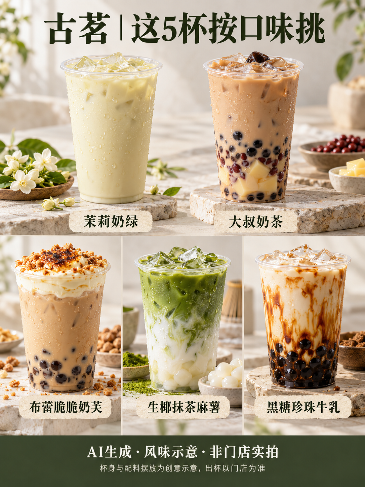
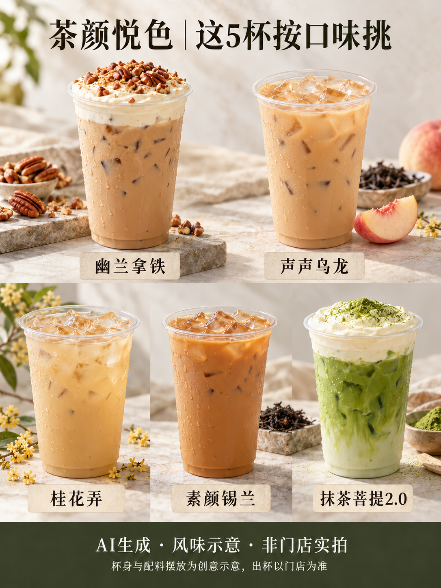
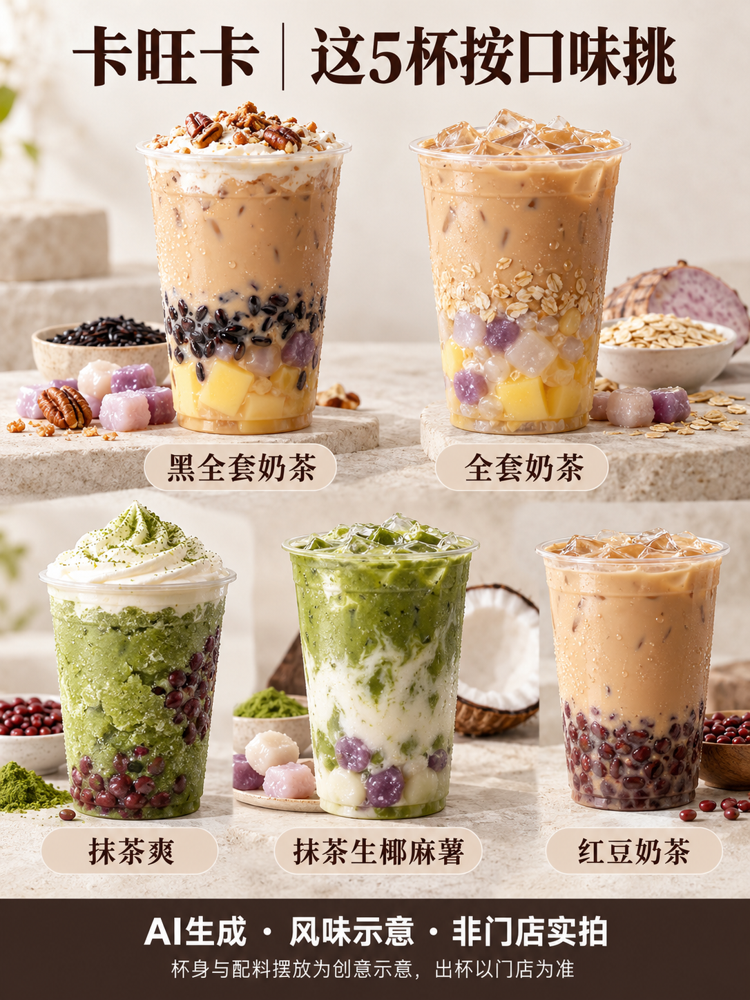

# 古茗、茶颜悦色、卡旺卡各推荐5款：15杯奶茶，按这4种口味挑

古茗、茶颜悦色、卡旺卡，哪家更容易点到自己喜欢的那一杯？

**配图说明：图片为AI生成的风味示意，杯身与配料摆放为创意表达，非品牌真实出杯。**

答案往往藏在配料和饮品形态里。同样是抹茶，有的配椰乳和麻薯，有的配奶油与红豆，还有的做成冰沙。只看“抹茶”两个字，预期就容易出现偏差。

这次从三家各选5款，整理成15杯的点单候选。名单依据公开产品介绍，未做现场逐杯试喝，不作销量排行；“适合谁”是按风味与配料作的选择建议。清单包括牛乳饮品与奶系冰沙。资料核对日期为2026年10月20日，具体在售和配方以当地门店为准。

## 第一类：想喝花香、红茶奶香，先看这4杯

**古茗·茉莉奶绿**，重点是茉莉绿茶与奶香。喜欢茉莉方向、暂时不想在多种小料之间做选择，可以先把它放进候选。

**茶颜悦色·声声乌龙**，产品介绍强调蜜桃风味与乌龙茶。它含乳制品，点单时要把它与纯茶区分开。想喝一点花果香的人，可以沿着这个方向选。

**茶颜悦色·桂花弄**，对应桂花乌龙风味，也含乳制品。声声乌龙和桂花弄之间，最直接的选择问题是：你今天更想要蜜桃风味，还是桂花香？

**茶颜悦色·素颜锡兰**，公开介绍为招牌幽兰的去奶油版本，落点在红茶和牛奶。喜欢红茶奶香、又不想要顶层奶油的人，可以优先考虑。

这4杯适合作为香气与茶奶风味的入口。“花香”“没有奶油顶”描述的是风味或结构，不能用来判断整杯是否无糖。

资料：[茉莉奶绿](https://www.nckfhsm.com/products/mo-li-nai-lv-25227)、[声声乌龙](https://www.nckfhsm.com/products/sheng-sheng-wu-long)、[桂花弄](https://www.nckfhsm.com/products/gui-hua-nong-cha-yan-yue-se)、[素颜锡兰](https://www.nckfhsm.com/products/su-yan-xi-lan)。

## 第二类：想要一杯甜品感，重点比较这3杯

**古茗·布蕾脆脆奶芙**，公开配料方向包括红茶、布蕾、珍珠、奶芙和坚果碎。它的吸引力在于顶层、布蕾与咀嚼口感的组合，适合把奶茶当下午茶甜点的人。

**茶颜悦色·幽兰拿铁**，可以抓住红茶、奶油顶和碧根果碎这几个关键词。想体验奶油顶与茶的搭配，可以从这一杯认识相应风格。具体是否加料，先按原配试过再决定。

**卡旺卡·黑全套奶茶**，包括红茶、黑米类配料、黑糖布丁、芋圆、奶油和碧根果碎等。三杯里若你最期待的是丰富的小料组合，可以优先核对它的点单介绍。

这组的选择重点是：想要布蕾和奶芙、红茶奶油顶，还是更丰富的小料？奶油和布蕾的形态会受温度与放置时间影响，拿到手后尽早享用，也比照着照片反复比较更实际。

资料：[布蕾脆脆奶芙](https://www.nckfhsm.com/products/bu-lei-cui-cui-nai-fu)、[幽兰拿铁](https://www.nckfhsm.com/products/you-lan-na-tie)、[黑全套奶茶](https://www.nckfhsm.com/zh-tw/products/hei-quan-tao-nai-cha)。

## 第三类：抹茶爱好者，有4种不同选择

**古茗·生椰抹茶麻薯**，产品资料列出抹茶、椰乳、麻薯和糯米小丸子。把它列入候选的理由，是椰香与软糯小料。

**卡旺卡·抹茶生椰麻薯**，公开介绍为抹茶与椰乳、厚乳的组合，配麻薯和芋圆。它与古茗那杯名字相近，但各有配方，收藏时可以连品牌一起记。

**茶颜悦色·抹茶菩提2.0**，产品介绍包含抹茶、黄油牛乳和奶油顶。想喝奶香抹茶，可以看它；点单时注意“2.0”版本与当天展示名称。

**卡旺卡·抹茶爽**，是抹茶、奶、红豆、奶油组合的冰沙款。想吃一杯冰甜点时，这个形态值得考虑；如果想喝热饮，就另选当天支持温热的单品。

把这4杯放在一起，选择会具体得多：今天想要椰香和糯感、黄油牛乳与奶油顶，还是红豆冰沙？公开产品资料不足以给三家排出统一“抹茶浓度榜”，这里也不作浓度高低判断。

资料：[古茗生椰抹茶麻薯](https://www.nckfhsm.com/zh-tw/products/sheng-ye-mo-cha-ma-shu)、[卡旺卡抹茶生椰麻薯](https://www.nckfhsm.com/zh-tw/products/mo-cha-sheng-ye-ma-shu-ka-wang-ka)、[抹茶菩提2.0](https://www.nckfhsm.com/products/mo-cha-pu-ti-2-0)、[抹茶爽](https://www.nckfhsm.com/products/mo-cha-shuang)。

## 第四类：围绕红豆、珍珠和多料，再看这4杯

**古茗·大叔奶茶**，以红茶配红豆、布丁和珍珠。想一次兼顾几种熟悉的小料，它是一个明确的候选。

**古茗·黑糖珍珠牛乳**，公开介绍主打黑糖珍珠与牛乳，并说明不含茶。喜欢黑糖奶香的人可以看它；它属于牛乳饮品，点单时与黑糖珍珠奶茶区分开。

**卡旺卡·全套奶茶**，产品介绍写到咖啡红茶、芋圆、燕麦、椰果和布丁。和黑全套相比，先比较原配，比只凭“全套”两个字作判断更清楚。

**卡旺卡·红豆奶茶**，适合围绕红豆这个方向选一杯。地方文旅介绍和门店资料都能找到这款；不需要把所有多料款都试完，才允许自己点一个熟悉的组合。

选择多料奶茶时，可以先想清楚想吃的配料，再决定杯子。第一次先试原配，下一次再调整，比较容易留下自己的口味记录。

资料：[大叔奶茶](https://www.nckfhsm.com/products/da-shu-nai-cha)、[黑糖珍珠牛乳](https://www.nckfhsm.com/en/products/hei-tang-zhen-zhu-niu-ru-29608)、[全套奶茶](https://www.nckfhsm.com/products/quan-tao-nai-cha-ka-wang-ka)、[红豆奶茶等经典款介绍](https://www.sohu.com/a/1013929131_121106832)。

## 每家5款，一张清单方便回看

- **古茗：**茉莉奶绿、大叔奶茶、布蕾脆脆奶芙、生椰抹茶麻薯、黑糖珍珠牛乳。
- **茶颜悦色：**幽兰拿铁、声声乌龙、桂花弄、素颜锡兰、抹茶菩提2.0。
- **卡旺卡：**黑全套奶茶、全套奶茶、抹茶爽、抹茶生椰麻薯、红豆奶茶。

打开当次门店菜单后，再确认三件事：有没有这款、当前是什么配方、允许怎样调糖冰。少糖或不另外加糖，也要结合小料本身的甜味来理解。对乳、蛋、坚果等原料有忌口，先看门店原料说明。

你最在意的，是茶香、奶油顶，还是红豆珍珠那一口？把偏好想清楚，这15杯就能缩小到几杯；最后喝哪杯，留给当天的心情。

---

资料说明：以上饮品信息为2026年10月20日公开资料的整理，第三方产品资料用于核对品名和主要风味，不能替代门店当前菜单。本文未附统一价格、销量排名或热量排名。正文及摄影风格示意图由AI辅助整理与制作，配图为AI生成摄影风格示意，杯身、层次和配料摆放不代表品牌真实出杯，非官方产品图及门店实拍；完整来源见配套《来源与口径.md》。
